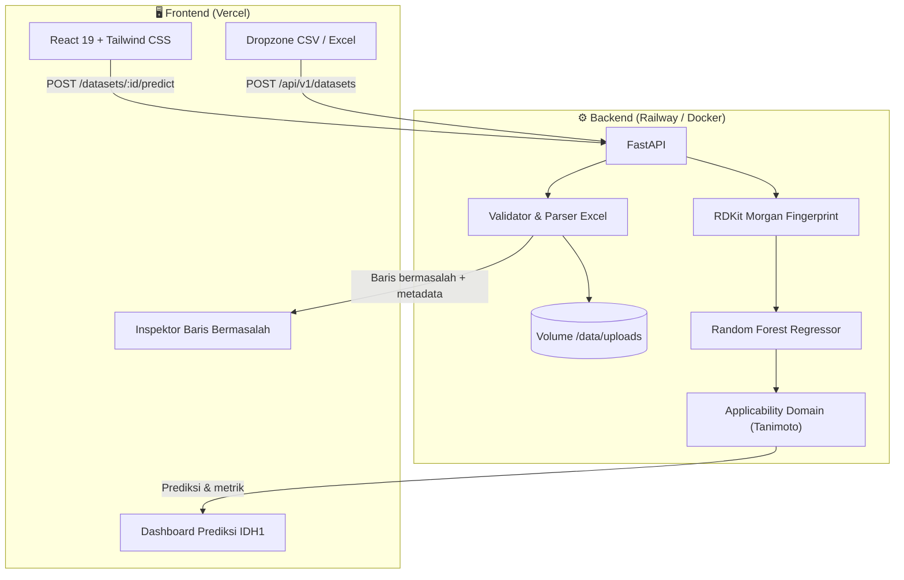

<div align="center">

# 🧪 QSAR Platform

### Validasi dataset molekuler & prediksi bioaktivitas IDH1 — dalam satu aplikasi web

Unggah CSV/Excel → temukan baris bermasalah → prediksi pIC₅₀ senyawa Anda.

[](https://react.dev/)
[](https://tailwindcss.com/)
[](https://fastapi.tiangolo.com/)
[](https://www.rdkit.org/)
[](https://scikit-learn.org/)
[](https://vercel.com/)
[](https://railway.app/)
[](https://opensource.org/licenses/MIT)

[✨ Fitur](#-fitur-utama) · [🏗️ Arsitektur](#️-arsitektur) · [⚡ Mulai Cepat](#-mulai-cepat) · [🚢 Deployment](#-deployment) · [📡 API](#-dokumentasi-api) · [🔬 Model](#-spesifikasi-model-qsar)

</div>

---

## 📖 Tentang Proyek

Kualitas dataset menentukan kualitas model — *garbage in, garbage out*. Dalam kimia komputasi dan *drug discovery*, masalah yang sering muncul:

| ❌ Masalah | ✅ Solusi QSAR Platform |
|---|---|
| BOM tersembunyi, delimiter tidak konsisten (`,` `;` tab) | Deteksi delimiter & encoding otomatis |
| Nilai kosong dan baris duplikat tidak terdeteksi | Pemindaian otomatis dengan laporan per baris |
| Sulit menemukan baris yang rusak di Excel | Penomoran baris **1:1 sesuai lembar kerja Excel** |
| Harus menulis skrip Python untuk prediksi | Inferensi Random Forest IDH1 langsung dari browser |

---

## ✨ Fitur Utama

### 📂 1. Unggah CSV & Excel
- Format `.csv`, `.xlsx`, `.xls` hingga **10 MB**
- Deteksi otomatis delimiter koma, titik-koma, dan tab
- Pembersihan BOM (`\uFEFF`) dan encoding fleksibel (UTF-8, UTF-8-sig, Latin-1, CP1252)

### 🔍 2. Pelacak Baris Bermasalah
- **Nomor baris sesuai Excel** — misalnya *Baris #20*
- **Pelacakan duplikat** — "Duplikat dari Baris #2"
- **Panduan perbaikan** langkah demi langkah
- **Pratinjau sel** dengan tombol salin ke clipboard
- **Ekspor** daftar masalah ke `.csv`

### 🧬 3. Prediksi QSAR untuk IDH1
- Standarisasi molekul dengan **RDKit**
- Deskriptor **Morgan Fingerprint (ECFP4)**, radius 2, 1024-bit
- Keluaran: **pIC₅₀**, **IC₅₀ (nM)**, dan kelas aktivitas

| Kelas | Rentang pIC₅₀ |
|---|---|
| 🟢 Highly Active | ≥ 7.0 |
| 🟡 Moderate | 5.0 – < 7.0 |
| 🔴 Inactive | < 5.0 |

- **Applicability Domain** berbasis kemiripan Tanimoto terhadap 4.235 senyawa referensi
- Ekspor hasil ke **CSV** dan **JSON**

### 🎨 4. Pengalaman Pengguna
- 🌐 **Dwi-bahasa** ID / EN (preferensi tersimpan di `localStorage`)
- 📱 **Responsif** untuk desktop, tablet, dan ponsel
- 🧪 **Dataset sampel** 1-klik: valid, dengan peringatan, atau rusak
- 📥 **Template unduhan** `.xlsx` dan `.csv` siap pakai

---

## 🏗️ Arsitektur



---

## ⚡ Mulai Cepat

**Prasyarat:** Node.js ≥ 18 dan Python 3.10 / 3.11

### Opsi 1 — Full-stack terpadu (paling cepat)

```bash
git clone https://github.com/username-anda/qsar-platform.git
cd qsar-platform

npm install

python -m venv .venv
source .venv/bin/activate        # Windows: .\.venv\Scripts\Activate.ps1
pip install -r backend/requirements.txt

npm run dev
```

Buka **http://localhost:3000** 🎉

### Opsi 2 — Backend & frontend terpisah

Cocok untuk mensimulasikan arsitektur production (Railway + Vercel).

<details>
<summary><b>Terminal 1 — Backend FastAPI</b></summary>

```bash
cd backend
python -m venv .venv
source .venv/bin/activate        # Windows: .\.venv\Scripts\activate
pip install -r requirements.txt
uvicorn app.main:app --reload --host 0.0.0.0 --port 8000
```

API aktif di `http://localhost:8000` — dokumentasi Swagger di `/docs`.
</details>

<details>
<summary><b>Terminal 2 — Frontend Vite</b></summary>

```bash
cp .env.example .env.local
# isi VITE_API_URL=http://localhost:8000 di .env.local
npx vite --port 5173
```

Frontend aktif di `http://localhost:5173`.
</details>

---

## 🚢 Deployment

Rekomendasi: **backend di Railway** (butuh runtime Python + RDKit) dan **frontend di Vercel** (CDN global, build cepat).

<details>
<summary><b>1️⃣ Backend → Railway</b></summary>

1. Buka [Railway](https://railway.app/) → **New Project** → **Deploy from GitHub repo**
2. **Settings** → **Root Directory**: `/backend` (Railway otomatis memakai [`backend/Dockerfile`](backend/Dockerfile))
3. Tab **Volumes** → **Add Volume**, mount path: `/data/uploads`
4. Tab **Variables**:

   ```env
   PORT=8000
   UPLOAD_DIR=/data/uploads
   QSAR_ARTIFACTS_DIR=/app/idh1_qsar_artifacts
   ALLOWED_ORIGINS=https://*.vercel.app,https://nama-domain-anda.vercel.app
   ```
5. Salin domain publik, lalu cek `https://<domain-anda>/health` → harus mengembalikan `{"status": "ok"}`
</details>

<details>
<summary><b>2️⃣ Frontend → Vercel</b></summary>

1. Buka [Vercel](https://vercel.com/) → **Add New… → Project** → impor repositori
2. Konfigurasi:

   | Pengaturan | Nilai |
   |---|---|
   | Framework Preset | Vite |
   | Root Directory | `./` |
   | Build Command | `npm run build` |
   | Output Directory | `dist` |

3. Tambahkan environment variable:

   | Key | Value |
   |---|---|
   | `VITE_API_URL` | URL backend Railway, **tanpa** garis miring di akhir |

4. Klik **Deploy** — selesai dalam ± 30 detik ✅
</details>

> [!TIP]
> [`vercel.json`](vercel.json) sudah menangani rewrite SPA, jadi refresh halaman di sub-rute tidak menghasilkan 404.

---

## 📡 Dokumentasi API

| Method | Endpoint | Deskripsi |
|:---:|---|---|
| `GET` | `/health` | Health check server |
| `POST` | `/api/v1/datasets` | Unggah & validasi berkas, hasilkan ringkasan |
| `GET` | `/api/v1/datasets/:id` | Metadata & status validasi |
| `GET` | `/api/v1/datasets/:id/issues` | Daftar baris bermasalah |
| `GET` | `/api/v1/datasets/:id/preview` | Pratinjau 10 baris pertama |
| `POST` | `/api/v1/datasets/:id/predict` | Jalankan inferensi QSAR IDH1 |
| `GET` | `/api/v1/datasets/:id/predictions/download` | Unduh hasil prediksi (`.csv`) |
| `GET` | `/api/v1/samples` | Daftar dataset sampel |

<details>
<summary><b>Contoh respons <code>GET /api/v1/datasets/:id/issues</code></b></summary>

```json
{
  "success": true,
  "data": {
    "problematic_rows_count": 1,
    "duplicate_rows": 1,
    "missing_values_total": 0,
    "problematic_rows": [
      {
        "row_number": 20,
        "data_row_index": 19,
        "issues": [
          {
            "type": "duplicate",
            "message": "Duplikat persis dari baris ke-2",
            "duplicate_of_row": 2,
            "suggested_action": "Baris ini identik dengan baris ke-2. Hapus baris ke-20 jika duplikasi tidak diinginkan."
          }
        ],
        "row_data": {
          "ID": "Morindone",
          "Smiles": "CC1=C(C2=C(C=C1)C(=O)C3=C(C2=O)C=CC(=C3O)O)O"
        }
      }
    ]
  }
}
```
</details>

---

## 🔬 Spesifikasi Model QSAR

| Aspek | Detail |
|---|---|
| **Target** | Isocitrate Dehydrogenase 1 (*Homo sapiens*) — ChEMBL `CHEMBL2007625` |
| **Relevansi** | Mutasi IDH1 diasosiasikan dengan glioma dan leukemia mieloid akut (AML) |
| **Standarisasi** | RDKit `rdMolStandardize`: fragment parent → neutralization → canonical isomeric SMILES |
| **Deskriptor** | Morgan / ECFP4, radius 2, 1024-bit |
| **Model** | Random Forest Regressor (`n_estimators=300`, `random_state=42`) |
| **Performa validasi** | R² = **0.81**, RMSE = **0.58** |
| **Applicability Domain** | Tanimoto maksimum ≥ **0.35** terhadap 4.235 senyawa latih (ChEMBL) → *Inside AD* |

---

## 📁 Struktur Repositori

<details>
<summary><b>Klik untuk melihat struktur folder</b></summary>

```text
qsar-platform/
├── backend/                         # FastAPI (siap deploy Railway)
│   ├── app/
│   │   ├── schemas/dataset.py       # Skema Pydantic
│   │   ├── services/
│   │   │   ├── csv_validator.py     # Validasi CSV/Excel
│   │   │   └── qsar_predictor.py    # Inferensi QSAR
│   │   └── main.py                  # Endpoint REST & CORS
│   ├── idh1_qsar_artifacts/         # Model .joblib & fingerprint referensi
│   ├── .env.example
│   ├── Dockerfile
│   └── requirements.txt
│
├── idh1_qsar_artifacts/             # Artefak model level root
├── public/                          # Aset statis
├── src/                             # Frontend React 19 + TypeScript + Vite
│   ├── components/                  # FormatExampleCard, HeroSection, Navbar,
│   │                                # UploadSection, ValidationResultSuccess, ...
│   ├── context/                     # LanguageContext, dll.
│   ├── lib/                         # Klien API (mendukung VITE_API_URL)
│   ├── locales/                     # Terjemahan ID & EN
│   ├── types/                       # Tipe TypeScript
│   ├── App.tsx
│   ├── index.css                    # Tailwind v4 & custom scrollbar
│   └── main.tsx
│
├── data/uploads/                    # Penyimpanan sementara berkas unggahan
├── predict_idh1.py                  # Skrip inferensi standalone
├── server.ts                        # Express + Vite (dev lokal)
├── vercel.json                      # Rewrite SPA
├── vite.config.ts
├── tsconfig.json
├── package.json
└── .env.example
```
</details>

---

## 🛡️ Keamanan & Privasi

- 🔐 **Nama file UUID v4** — mencegah *path traversal* dan bentrok nama
- 🧼 **Tanpa eksekusi kode arbitrer** — parsing lewat `PapaParse` dan `pandas` dengan tipe data terkontrol
- 🗑️ **Pembersihan berkala** berkas unggahan dari penyimpanan sementara

---

## 📄 Lisensi

Dirilis di bawah [MIT License](LICENSE) — bebas digunakan untuk riset akademis maupun komersial.

<div align="center">
  <sub>Dikembangkan untuk penelitian komputasi & penemuan obat berbasis QSAR 🧬</sub>
</div>